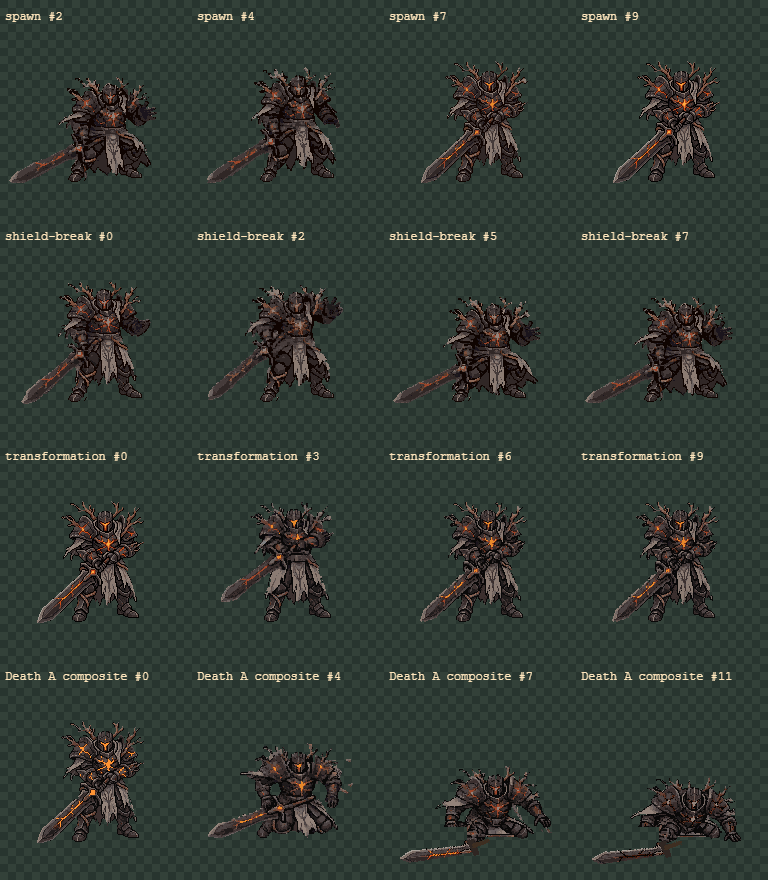
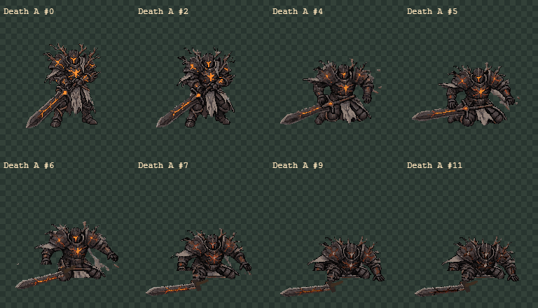
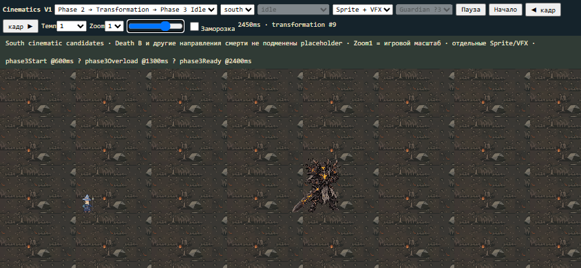
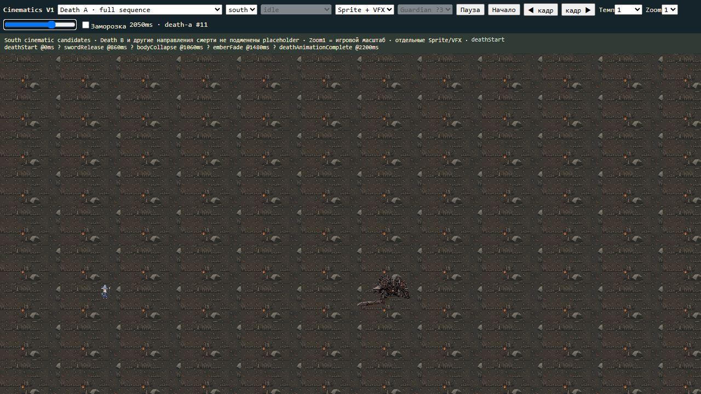
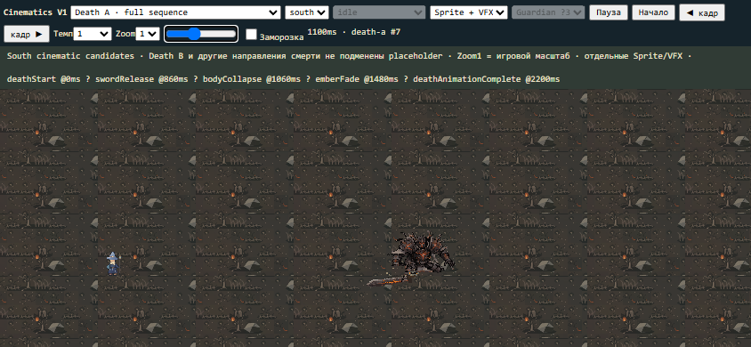
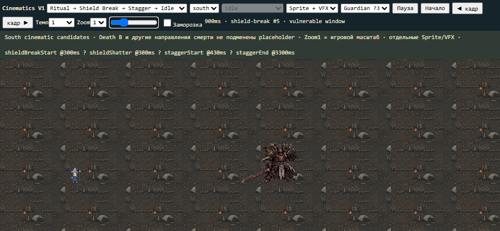

# Ash Warden Cinematics V1 — 2026-11-07

**Подготовлен доступный South cinematic pack для ручной приёмки: Spawn,
Shield Break/Stagger, Transformation и один Death A.** Death B и другие
направления смерти не создавались из-за остатка Starter-квоты; замены-плейсхолдера нет.
Принятые ранее пакеты и production runtime не изменены. Работа в main,
без commit/push/deploy или новой ветки.

[Открыть viewer](../../art/generated/ash-warden-cinematics-v1/viewer.html).

|Анимация|GIF|Длительность|
|---|---|---:|
|Spawn body|[Spawn](../../art/generated/ash-warden-cinematics-v1/spawn/preview.gif)|2300ms/10frames|
|Shield Break body|[Shield Break](../../art/generated/ash-warden-cinematics-v1/shield-break/preview.gif)|1040ms/8frames|
|Held stagger|[Stagger](../../art/generated/ash-warden-cinematics-v1/stagger/preview.gif)|500ms held pose|
|Recovery|[Recovery](../../art/generated/ash-warden-cinematics-v1/stagger-recover/preview.gif)|700ms/7frames|
|Phase3 Transformation body|[Transformation](../../art/generated/ash-warden-cinematics-v1/transformation/preview.gif)|1800ms/10frames|
|Death A combined review|[Death A: body+sword+emission fade](../../art/generated/ash-warden-cinematics-v1/death-a-composite-review/preview.gif)|2200ms/12frames|
|Death A body only|[Body](../../art/generated/ash-warden-cinematics-v1/death-a/preview.gif)|2200ms/12frames|
|Separate weapon|[Sword Drop](../../art/generated/ash-warden-cinematics-v1/sword-drop/preview.gif)|440ms/5frames, final held|

Body GIF не содержит щит, пепел или другие отдельные VFX. Combined Death —
отдельный review export; runtime bindings используют самостоятельные body/layers.
В viewer доступны оба слоя вместе, отдельно и prepared/source comparison.

## Движение и художественные решения

**Death A — главный новый материал.** Один RD Custom Action из принятого South
создал настоящие изменения коленей, бёдер, плеч и положения корпуса. Босс
оседает, теряет хват меча и выносит вес вперёд на руки. Это не вращение/масштаб
одного PNG и не fade тела. В raw10/11 голова немного поднималась; prepared
сохраняет0..9 и держит9 ещё2кадра, с индивидуальными durations и отдельным угасанием.
Остаётся низкая фигура на коленях/руках; полное падение грудью плашмя не достигнуто
и не заявляется. Это существенная тема художественной приёмки, а не скрытый эффект.

В первых3review кадрах отдельный fatal-hit emission даёт короткую вспышку
трещин/визора; это не tint всего тела. Меч после frame6/860ms — самостоятельный sprite. Его принятую фактуру клинка
выделили локально, guard/hilt восстановлены малыми программными полигонами.
Убраны видимые blade/hilt pixels из лежащего raw weapon в body; маски и counts
в death-sword-cleanup.json. Меч падает под действием собственной траектории,
контакт970ms даёт небольшой stone/ash impact. На полу остаётся цельный меч.
В body нет второго полного клинка. С1480ms гаснут трещины, визор и затем клинок;
сам корпус, ветви и табард не растворяются.

**Shield Break.** Второй RDзапрос из принятой Ritual Channel дал крупный recoil
плеч/корпуса, приседание, потерю устойчивости и восстановление. В подготовленном
клипе первый кадр равен acceptedChannel0. Он заканчивается низкой опорой;
held stagger и отдельное recovery заполняют оставшуюся часть трёхсекундного окна.
Иммунитет должен сниматься при shatter, а не после анимации. Щит/обрыв лучей/
энергетические фрагменты отдельны. Показаны3Guardian и облегчённый повтор2Guardian.

**Spawn.** Использует физические позы выпрямления из новой Shield sequence,
а не новую модель: после500ms ash-only появляется низкий silhouette, плечи и
корпус поднимаются, меч возвращается в low guard, финал — acceptedIdle0.
Matte reveal, ground particles, каменный импульс и короткий visor/magma glow
отдельные. Есть движение персонажа помимо появления/прозрачности.

**Transformation.** Несколько ключевых поз из новой braced sequence и принятых
Cleave1/2 дают выпрямление/сжатие двуручного хвата/небольшой подъём меча и
напряжённую готовую стойку. Не используется атакующий release Cleave. Магматическая
пульсация и ash burst — отдельные слои; весь корпус не перекрашивается в оранжевый.

## Phase3 persistence

191frame bindings,137unique sparse emission textures, atlas1024×2048RGBA=8MiB.
Покрыты текущие Idle/Walk/Basic Melee4directions, CastB4directions,
ChargeSouth3фазы, CleaveSouth и принятый South Ritual. Отсутствующие ранее
направления Charge/Cleave не выдумывались. Полных новых body packs дляPhase3 нет.
Source sprites не меняются; emission source pose/frame переключается атомарно.

Freeze удерживает frame и mask, прерывание/смена действия не сбрасываетPhase3 latch.
В одном North Melee кадре нет открытых горячих пикселей: overlay=null, состояние
сохраняется, рядом остаются4малых отдельных ember particles. Маска предыдущего
кадра не накладывается на другую позу. Death имеет приоритет над постоянным glow.
После Transformation готовая поза — referenceCleave1 с напряжённым low sword guard;
это не новая внешность босса.

## Общие timelines

|Сценарий|События, ms|
|---|---|
|Spawn|Start0 → Reveal500 → Ready2300|
|Shield|BreakStart/Shatter300 → StaggerStart430 → StaggerEnd3300|
|Phase3|Start600 → Overload1300 → Ready2400|
|Death A|Start0 → SwordRelease860 → Collapse1060 → EmberFade1480 → Complete2200|

У Shield300ms Channel lead-in, затем1040ms реакция, held pose, recovery2600–3300.
Окно уязвимости300..3300 =3000ms. Transformation имеет600ms обычной Phase2стойки
перед собственным1800ms клипом. Эти шкалы разделены в metadata/events.
End events используют frameExclusive. Scrub/pause/step не диспатчат события,
повторное пересечение не создаёт дублей. Restart viewer — новый preview encounter.

## Просмотр в реальном масштабе

Desktop1280×720/mobile844×390 проверены вZoom1, worldScale0.6548310811,
рядом Mage reference.4× используется только в exported pixel sheets.
Viewer имеет все4сценария, play/pause, frame step/scrub,0.25/0.5/1/2,
freeze, Sprite/VFX/both, persistent-action/direction selector, общие event markers,
поддержку повторной Guardian-волны и честно отключённый Death B.
Смерть других направлений не проверялась: их нет в пакете.

## Проверки и память

- Принятые пакеты/src/public:1466SHA256совпадают с baseline, включая Magic V1.
  Не изменён даже прежний viewer; новыйcinematics viewer самостоятельный.
- Все новые кадры192×192RGBA, общийpivot/scale, без bbox fitting и edge clipping.
- Строгая ImageDecoder GIF/PNG проверка охватывает все body/layer/VFX/review clips.
  Отдельно проверены точная реконструкция137atlas masks и соответствие191source poses.
- Полные Spawn/Shield/Transformation/Death playback на обоихviewport, единичные
  события, очистка transient VFX, повторный scrub безdispatch, freeze/interruption
  Phase3 и все доступные направления persistent-action bindings.
- Выявлен и исправлен RGB/RGBA аргумент procedural shield shards, создававший
  скрытый RGB у прозрачных пикселей; проверки не ослаблялись.
- Fixed-size status/event fields предотвращают изменение высоты header во время
  проигрывания; проверка scroll overflow сохранена.
- Будущий новый body/layer/VFX atlas:84unique textures, shelf1024×1024=4MiB;
  с Phase3atlas8MiB суммарно12MiBRGBA. Это оценка без прежнихbaseatlases,
  driver overhead иreview-composites. Тримминг хранит исходныеoffsets192, не fitting.
- npmruncheck: typecheck/lint,655тестов/82файла,build; логcheck.log.
  gitdiffcheck. ПрежнийVitebundlewarning остаётся. GameplayE2Eне запускались:
  World/FinalEncounter/AI/health/damage/victory runtime не менялся.

Финальная проверка:19GIF/158кадров,72desktop/mobile screenshots,2comparison
sheets и1диагностический×4crop. Точные counts/результаты находятся вvalidation.json и
runtime-memory-validation.json; source-generation manifests и все scripts рядом.

## Расход, готовность и ограничения

2RD Custom Action192×192: DeathA seed6110731/task08917f51-bd07-44fd-99e6-5af5017c6c85,
Shield seed6110732/taske17c211a-c2ad-4c3b-911f-2b39f794b7c2. Перед каждым проверены
balance/jobs/styles/free estimate, параметры сохранены. Оценка$0.25+$0.25ifbalance.
Actual$0, billingplan, balance$10→$10. Starter51→44%=7п.п. из10; осталось3п.п.
Наблюдавшийся debit одного такого запроса — до4п.п., поэтому optionalDeathB
не запускался: нельзя надёжно уложить его в floor41. Неиспользованный денежный
лимит не отменяет независимый Starter ceiling. Paid retries0, другихгенераторов0.

Готово для ручного просмотра: South Spawn, Shield Break/Stagger/Recovery,
Transformation, Phase3persistent overlay, SouthDeathA и отдельный Sword/Ash/Ember/
ShieldVFX. Не готово: DeathB и North/East/WestDeath; placeholders вместо них нет.
Дальнейший polish: более окончательный завал груди DeathA (текущий финал —
низкая опора на колени/руки), стык кистей/рукояти приrelease, меньше RDmorphing
плеч/меча вShield/Spawn, дополнительная выразительность Phase3stance.
Финальная художественная победа кандидата не назначена автоматически.

Следующий шаг — ручная приёмка доступного пакета. Только затем интеграция
event/latch/cleanup/victory gates: при HP0 отменить hostile damage один раз,
дождатьсяdeathAnimationComplete и показатьvictoryUI; не допустить defeat после
boss death. Текущий FinalEncounter.finish сразу ставит over — это отдельно
зафиксировано для следующей интеграции, сейчас не менялось.
