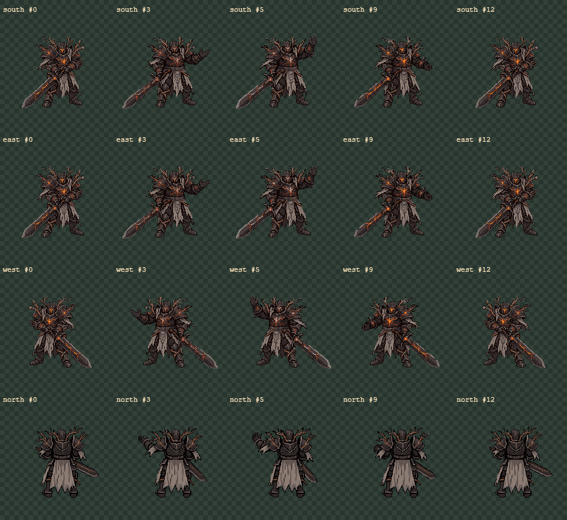
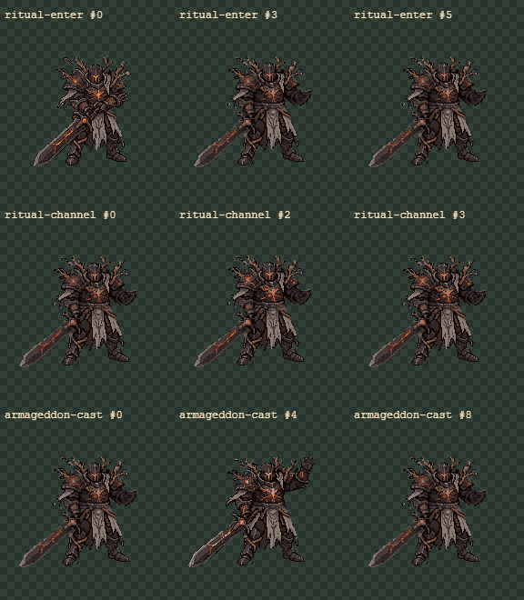
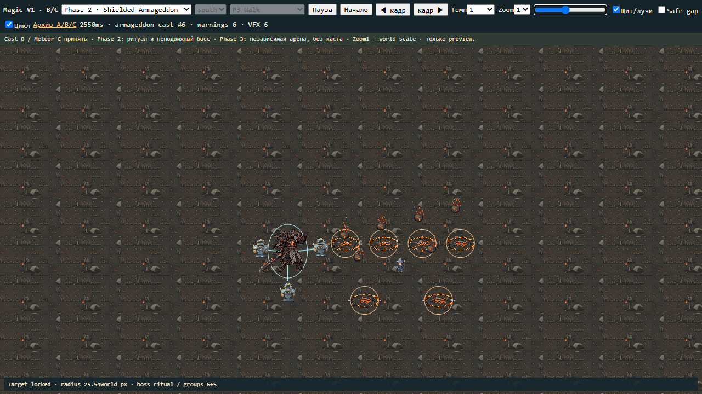
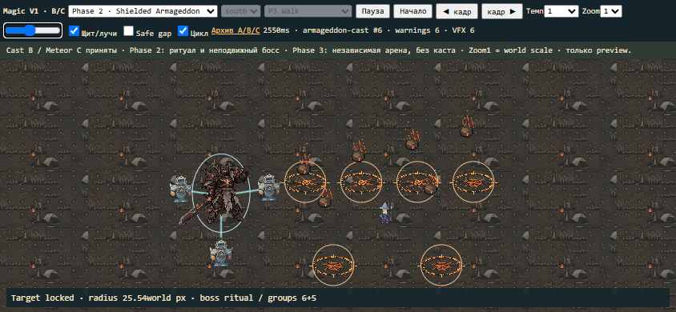
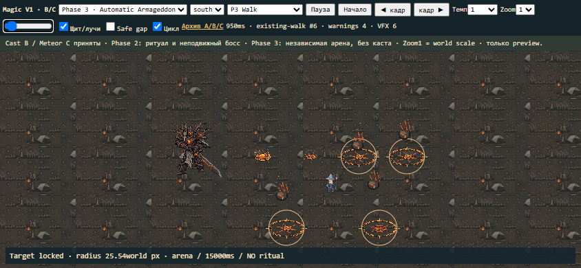

# Ash Warden Magic Pack V1 — 2026-11-07

**Подготовлены4Cast B и самостоятельный South Guardian Ritual; Meteor C
переиспользуется в Single, shielded Phase2 и automatic Phase3. Ручная приёмка ожидается.**
Принятые South B и все компоненты C сохранены побайтно. Производственные
AI/World/Guardian, баланс, phase transitions и runtime assets не изменены.
Работа выполнена в main, без commit/push/deploy и без новой ветки.

## GIF и viewer

[Открыть Magic V1](../../art/generated/ash-warden-magic-pack-v1/viewer.html).
Прежний `art/generated/ash-warden-meteor-v1/viewer.html` открывает тот же новый
viewer. Из старого пакета изменён только этот разрешённый preview entry;
source sprites/data/modules сохранены. A/B/C comparisons доступны в архиве.

|Клип|GIF|Длительность|
|---|---|---:|
|Cast South B|[South](../../art/generated/ash-warden-magic-pack-v1/cast-south/preview.gif)|13/1440ms|
|Cast East B|[East](../../art/generated/ash-warden-magic-pack-v1/cast-east/preview.gif)|13/1440ms|
|Cast West B|[West](../../art/generated/ash-warden-magic-pack-v1/cast-west/preview.gif)|13/1440ms|
|Cast North B|[North](../../art/generated/ash-warden-magic-pack-v1/cast-north/preview.gif)|13/1440ms|
|Ritual Enter|[Enter](../../art/generated/ash-warden-magic-pack-v1/ritual-enter/preview.gif)|6/900ms|
|Ritual Channel|[Channel](../../art/generated/ash-warden-magic-pack-v1/ritual-channel/preview.gif)|4/800ms loop|
|Armageddon Cast|[Activation](../../art/generated/ash-warden-magic-pack-v1/armageddon-cast/preview.gif)|9/1200ms|

South: неизменённые13review кадров и timing, release550ms. East: те же upper,
кисти, броня, голова и меч, с отдельно обработанной устойчивой опорой ног.
West — точное x'=191−x, общий pivot(96,154), без обрезания и доп.регистрации.
North —1RDзапрос из принятой модели со спины: рука поднимается выше плеча,
броня/шлем со спины, низкий меч. Фронтальные пиксели в North не вставлялись.
Original12×150ms/PNG сохранены; review13 использует тайминг South и endpoint raw0.

## Guardian Ritual

Enter переводит B0/B1 в B2 с более широкой опорой, свободной поднятой рукой
и усилением существующих magma цветов. Channel держит эту позу: слабый световой
цикл и1px движение верхней части при неизменных ногах. Меч остаётся низким.
Armageddon идёт из Channel вверх кB5, держит явную активационную позу и
возвращает руку. Он не воспроизводит обычный полный Cast B из Idle.
Enter last = Channel first = Armageddon first/last, подтверждено pixel-exact.
В standalone viewer Enter/Activation также продолжаются в Channel.

Ритуал сейчас **South only**, что явно записано в metadata и UI. Это не четыре
независимых ritual pack и не подмена North фронтальной картинкой. Для данного
неподвижного shielded presentation выбран один South ritual. Все4Meteor Cast готовы.

Shield и3луча существуют отдельно от body PNG. Preview переиспользует текущий
Guardian atlas/idle frames и рисует векторный щит/лучи; blueprint сохранён в
guardian-shield-vfx.json. Новых Guardian атак или shield mechanics не добавлено.

## Single и общий timeline

|Cast start / warning / target lock|Release|Fall start|Impact|Aftermath|VFX end|Cast end|
|---:|---:|---:|---:|---:|---:|---:|
|0|550|600|900|1080|1400|1440ms|

Warning начинается сразу с cast windup, а не в момент release, как в старом
candidate viewer. Так release предшествует fall на50ms; ring/fall заканчиваются
ровно при contact. Сам Cast B не ускорен и не сдвинут внутри клипа.
Relative offsets Meteor C0/600/900/1080 сохранены. Target фиксируется в0 и
не переносится к движущемуся игроку. События и выбранные offsets в timing-events.json.

## Phase 2 и Phase 3

P2: Enter0–900 → Channel → Armageddon Cast1700–2900 → Channel.
Boss root неподвижен. Release2030ms; первая группа6warnings начинается1700ms,
вторая5 —3250ms, внутри групп шаг50ms. После4850ms VFX чисты; Channel/щит
остаются. Viewer полностью проигрывает6000ms. Щит/лучи можно скрыть.

P3: две такие же группы поarena clock, повтор через15000ms. Босс независимо
проигрывает принятый Walk/Idle/Basic Melee B; Ritual/Cast не включаются.
Walk движется по preview траектории со speed72 из текущего config и подходящим
presentation direction. Проверен19s playback, включая второй запуск на15s.
Это не изменение Phase3 или частот в production.

Одновременно максимум6warnings; circle boundaries не заполняют всё поле.
Обе сцены используют те же23Cframes, без PNG на каждый экземпляр.
Source C/кольцо/пепел/контакт/aftermath не заменены упрощённой графикой.

## Danger zones и важная граница интеграции

Принятое кольцо C — перспективный эллипс, а текущая World/FinalEncounter damage
проверка — circle radius42 и warning1300ms. Новый preview не выдаёт их за уже
согласованные. Добавлена отдельная тонкая круговая граница, точно соответствующая
preview danger circle radius25.5384worldpx, производной от39sourcepx×scale.
Она живёт доimpact и постоянна в world при смене zoom/viewport. PNG C не меняются.
Это reference geometry, а не новый принятый баланс. При интеграции обязательно
согласовать actual damage radius, VFX scale/outline и warning duration.

Helpers проверяют circle intersections, safeAt, reachable safe samples,
плотность и две группы. В постановке сохранён горизонтальный коридор шириной36worldpx;
проверка достижимых позиций учитывает speed72, warning0.9s и playerPadding6.
Проверены обе группы и15s repeat с шагом50ms. Это проверка конкретного preview,
не гарантия для произвольного рандомного Armageddon. Новый planner обязан проверять
плотность/достижимость заново при другом radius или размещении.

## Экспорты, reuse и проверки

Каталог: `art/generated/ash-warden-magic-pack-v1/`.7клипов,71reviewPNG,
7GIF/sheets/nearest×4, Northraw12PNG/GIF/sheets,2comparison sheets,
48desktop/mobileCanvas screenshots, metadata/events/texture-reuse/group-layout,
shield blueprint, manifests/expenses, исходные build/decode/viewer/helpers/tests.
Команды и подробный интеграционный контракт — `INTEGRATION_NOTES.md`.

Runtime descriptors разделяют S/E upper и ноги; West использует East+flipX.
textures/ содержит58уникальныхhash-текстур; duplicate poses не создают повторных runtime textures.
C загружается один раз по ссылкам из принятого пакета; Single/P2/P3 имеют только
независимые target/time/instance records. В reuse test число загруженных images
не меняется при переключенииSingle→Phase3. Проверена точная сборка layered S/E PNG.

- SHA2561153защищённых файлов совпадают с baseline: прежние анимации, metadata,
  исходники src и public. Единственное исключение — явно разрешённый Meteor viewer entry.
- South PNG/durations совпадают побайтно; Westmirror и shared upper проверены.
- Все7новыхGIF проверены поRGBA SHA256 каждого кадра и durations через ImageDecoder.
- Проверены transparency/no edge clipping, согласованные ritual endpoints,
  предупреждение доfall/impact, отсутствие VFX после окончания.
- Playwright1280×720 и844×390: полноценныеP2/P3playback,9режимов доступны,
  все4Cast,frame stepping,rate0.25/0.5/1/2,shield toggle,Idle/Walk/Melee вP3,
  повтор на15s,очистка,texture reuse,без JS errors и scroll overflow.
- Canvas screenshots, rawNorth, ritual sheets и desktop/mobile сцен реально просмотрены.
- Старый candidate archive отдельно открыт Chromium: исходные modules/images загружены,
  pageerror0; результат в archive-validation.json. Play-rate0.25/0.5/1/2 измерены
  за500ms каждого темпа на обоих viewport и соответствуют выбранному множителю.
- npmcheck:655/655тестов из82файлов,typecheck/lint/build, exit0; git diff --check.
  Прежний Vite bundle-size warning остаётся. Gameplay E2E не запускались: runtime не менялся.

## Расход и polish

1RetroDiffusion Custom Action192×192 дляNorth,seed6110721,
task a4453483-6a70-434a-92ce-7925cf7cd568, backendrd_fast.
До запроса проверены баланс/styles/free estimate/jobs. Estimate$0.25ifbalance,
actual$0,billingplan,balance$10→$10. Starter54→51%=3п.п. из разрешённых5.
Paid retries0,Southgen0,Ritualgen0,MeteorCgen0,другихгенераторов0.

Готовы к приёмке:4Cast B,Enter/Channel/Armageddon South,Single/P2/P3visuals,
MeteorCbindings,timelines,layout/safetyhelpers. Placeholder-клипов нет.
Polish backlog: North кисть/foreshorteningмеча; небольшая пиксельная деформация
голеней East/ритуала; более естественное плечевое дыхание Channel вместо1px-bob;
подбор яркости пульса брони. Это остаётся ручной художественной оценкой.

Следующий этап: после приёмки интегрировать asset/event bindings и pool/lifecycle,
отдельно согласовать radius/timing и перенести P2/P3семантику в FinalEncounter.
Текущий runtime под щитом кастует одиночныйmeteor, а Phase3откладывает волну во
время charge/sword — это отмечено, но не исправлялось в арт-задаче.
Работа остановлена для ручной приёмки Magic Pack V1.
