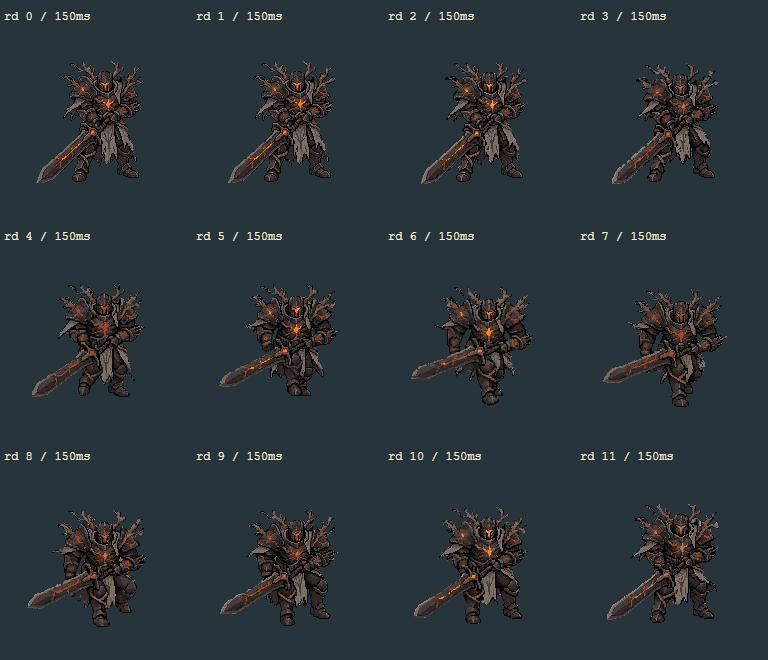
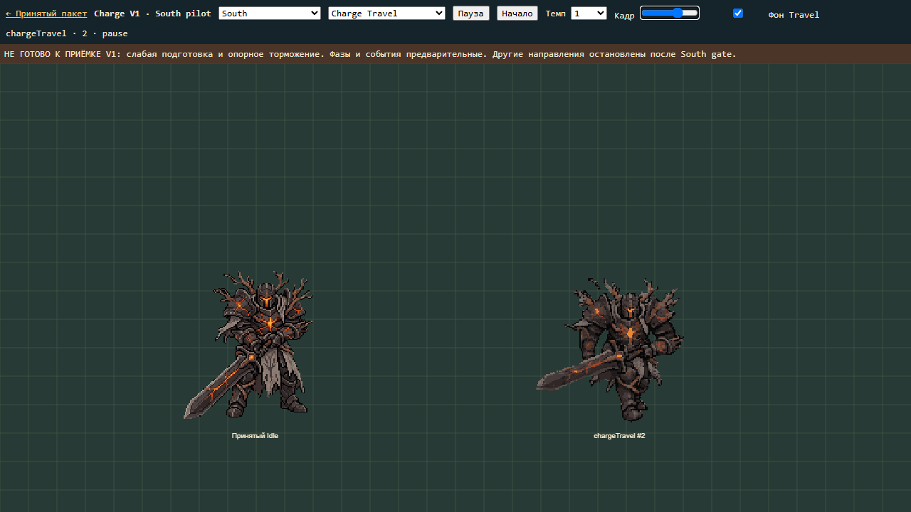
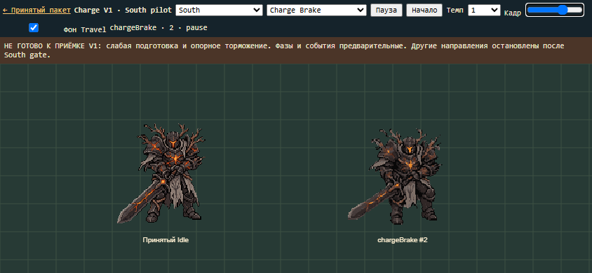

# Ash Warden Charge V1 — South pilot, 2026-11-07

**Статус: полный Charge V1 НЕ готов. South pilot не прошёл художественный gate.**
Выполнена одна генерация RetroDiffusion; East/West/North остановлены до исправления
кинематики South. Это диагностический пакет для просмотра, а не принятые игровые ассеты.
Нет commit, push, deploy или изменений AI, hitbox, баланса и production assets.

## Визуальный результат



Положительное: в позах4–7 меняются колени и опора, голова/плечи опускаются,
меч удерживается низко, нет overhead cleave, blur, телепорта или встроенного VFX.
Шлем, броня, оранжевые трещины, ветви и табард узнаваемы. Это отдельные позы,
не ускоренный Walk. Но для принятия Charge этого недостаточно:

- 0–3 слишком близки к Idle; нет убедительного широкого приседа и накопления импульса.
- 4–7 дают шаг с подачей корпуса, но сильный наклон тяжёлой кирасы недостаточно читается.
- 8–11 распрямляют модель, не показывая ясную вынесенную опорную ногу и тяжёлое торможение.
- В конце11→Idle0 заметен morphing/смена силуэта. Переход в Cleave визуально не подтверждён.
- Обе кисти находятся у рукояти, однако непрерывность контакта и форма локтей требуют polish.

Первые три пункта — блокеры кинематики, а не допустимые мелкие дефекты голеней V1.
Они не исправлялись масштабированием, ускорением Walk или подменой боевой логики.
North не генерировался по прямому правилу пользователя о неубедительном South pilot.

## Экспорты и воспроизведение

Каталог: `art/generated/ash-warden-charge-v1/`.

- `south-rd-original.gif`: неизменённый оригинал RD, 12×150ms=1800ms.
- `originals/south-input.png`: тот же ранее принятый фронтальный исходник192×192.
- `south-rd/frames/`:12 исходных RGBA PNG; sheet, strip, nearest×4, canvas screenshot и frame metadata.
- `south/chargeWindup/`: исходные0–3, длительности180/170/160/140ms=650ms.
- `south/chargeTravel/`:4–7,80/100/120/120ms=420ms.
- `south/chargeBrake/`:8–11,70/70/80/80ms=300ms.
- Каждый клип имеет PNG, spritesheet, GIF. `south/full-charge.gif`: Idle450→фазы1370→Idle450.
- `animation-metadata.json`, `timing-events.json`, `generation-manifest.json`, `south-job.json`, `expenses.json`.
- `viewer-before.html`: копия прежнего viewer; `protected-baseline.json`:SHA256322 файлов принятого пакета.

Это предварительное разбиение для диагностики. Кадры не подгоняются по bbox, не
масштабируются отдельно:192×192, pivot(96,154), worldScale0.6548310811.
Нет изменения игрового перемещения. В preview двигается только процедурный фон.

Команды из корня проекта:

```powershell
node art/generated/ash-warden-charge-v1/decode.mjs south-rd
node art/generated/ash-warden-charge-v1/build-pilot.mjs
node art/generated/ash-warden-charge-v1/verify-viewer.mjs
node art/generated/ash-warden-charge-v1/protect.mjs --verify
npm.cmd run check
```

Скрипты используют существующие Playwright Chromium, PNG и GIF encoder проекта.
Платных повторов в них нет. Полученный файл скачан Python urllib после ошибок
Windows TLS и сетевого EACCES Node REPL; повторной генерации не было.

## Предварительные события

Время относительно начала Windup; Idle lead-in preview не входит в контракт.

|Событие|ms|Поза|
|---|---:|---|
|chargeWindupStart|0|Windup0|
|directionLock|510|Windup3|
|chargeStart|650|Travel0|
|chargeTravel|730|Travel1|
|chargeStop|1070|Brake0|
|chargeBrakeEnd|1370|Idle0|
|recoveryEnd|1370|Idle0|

Direction lock предшествует старту. Combat direction South/[0,1] хранится отдельно
от front presentation. Трекинг игрока после lock запрещён контрактом metadata.
Ничего из этого не подключено к gameplay; события помечены provisional.

## Проверки





Реальные Canvas screenshots просмотрены: sheet12 поз, desktop Travel1280×720,
mobile Brake844×390. На малом экране обе фигуры и подписи помещаются, растровый
фильтр nearest. Сравнение с Mage/Burning Grove и все четыре направления не
проверялись: полный пакет остановлен по South gate.

`verify-viewer.mjs`: оба viewport, Idle/Walk/Basic Melee B/три Charge-фазы/Full,
темп0.5/1/2, один directionLock и chargeStart за последовательность, возврат в Idle,
отключение движения фона, отсутствие pageerror и горизонтального overflow.
JSON результатов и16 screenshots сохранены рядом. Техническая проверка возврата
в Idle не означает художественно плавный переход — скачок11→Idle остаётся блокером.
Доступ из существующего viewer — ссылка Charge V1 South pilot; принятый viewer
сохранил свои режимы. Остальные Charge-направления явно недоступны.

SHA256: все322 файла `ash-warden-directional-melee-b-v1/` неизменны.
Первый `npm run check` прошёл655 тестов/82 файла, typecheck/lint/build.
При добавлении скриптов найдены3 lint ошибки; исправлены, итоговая проверка
фиксируется в `validation-check.log`: exit0,655/655 тестов,82файла, typecheck,
lint и build успешно. Предупреждение Vite о размере bundle остаётся прежним.
Gameplay E2E не запускались.

## Расход и следующий шаг

Одна генерация Custom Action192×192, frames_duration12, seed6110701,
backend ответа `rd_fast`, task `0ae4f588-c556-4df4-ae55-6c23ebb3eed5`.
До неё проверены styles, свободные job slots и последние jobs; активных0.
Оценка$0.25 if balance, фактическое списание$0, billing plan.
Баланс$10→$10, Starter64→минимум60→финально61%. Консервативно4п.п.,
в пределах$1/5п.п. Ни North, ни повторный South, ни другие генераторы не запускались.

Следующий художественный шаг: исправить South Windup и Brake, заново оценить
тяжесть корпуса и контакты кистей. Только после убедительного South строить East
с общим front upper и направленными ногами, точное зеркало West и North со спины.
Затем необходимы все4 GIF, pivot/mirror проверки, Mage comparison и полноценная
проверка межфазных переходов. Маркер done не создан. Работа остановлена для
ручного просмотра pilot; полный V1 не объявляется завершённым.
