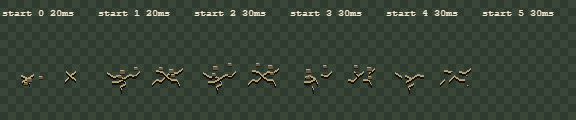
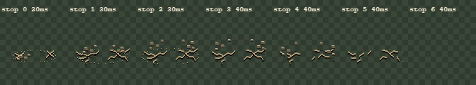
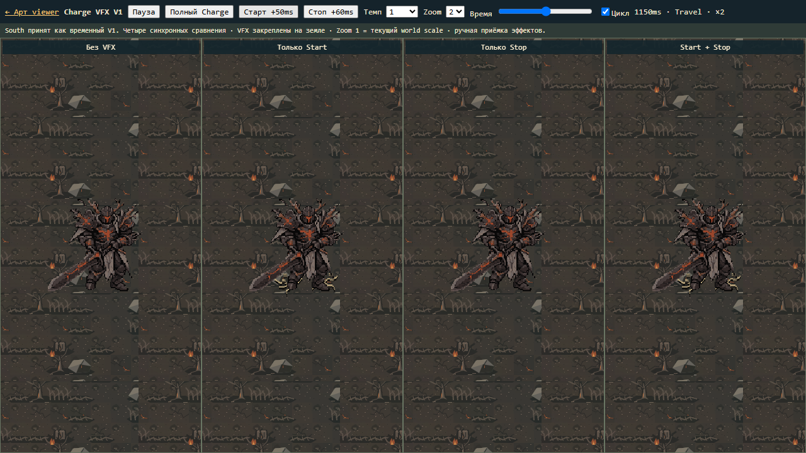
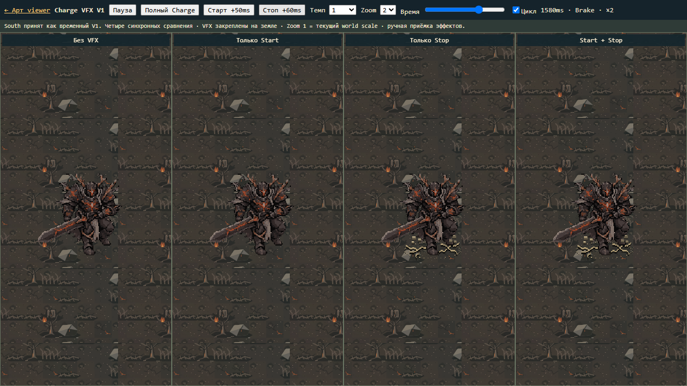
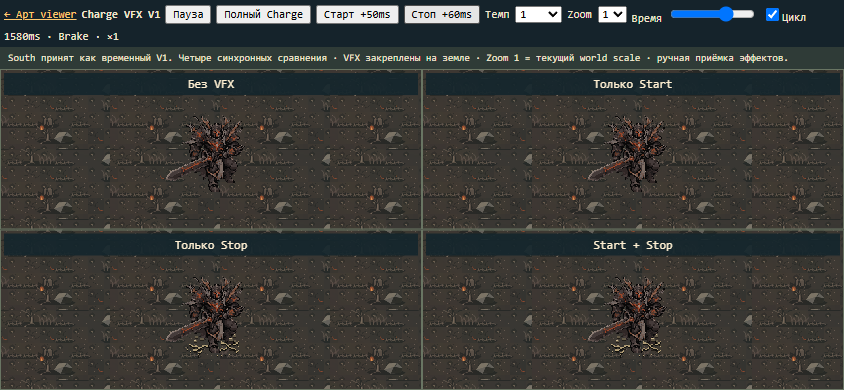

# Ash Warden — Charge VFX V1 — 2026-11-07

**Два отдельных эффекта подготовлены для ручной приёмки.** South Charge принят
пользователем как временный V1; его кадры, metadata и старый viewer не изменены.
Новый preview использует этот пакет как read-only источник. Ни генерации, ни
перерисовки босса, ни интеграции gameplay не было. Текущая ветка — main.

## Эффекты

|Эффект|Событие|Кадры|Длительности кадров|Всего|
|---|---|---:|---|---:|
|Charge Start Ground Crack|chargeStart|6|20/20/30/30/30/30ms|160ms|
|Charge Stop Mini-Quake / Rock Burst|chargeStop|7|20/30/30/40/40/40/40ms|240ms|

Старт: две локальные ветвящиеся трещины у опор ног, до6 мелких осколков.
Остановка: более сильная реакция той же земли, до8 осколков с более высоким
разлётом и короткая разорванная овальная линия сжатия на первых3кадрах.
Тёмная щель и светлая каменная кромка создают контраст с Burning Grove;
нет огня, glow, кратера, dust cloud, размытия или cinematic slam.

Все исходники — оригинальная детерминированная программная pixel-art композиция.
В первом визуальном проходе тонкая кромка терялась в грунте; она усилена до
нескольких source pixels, камни увеличены на1px. Площадь непрозрачных пикселей
на пике:527Start и664Stop из9216, менее8%canvas. Последний кадр полностью пустой.
Это небольшая реакция вокруг ног; кираса и силуэт босса остаются главным объектом.

## Ассеты и контракт

Каталог: `art/generated/ash-warden-charge-vfx-v1/`.

- `source.mjs`: authored crack paths, палитра, траектории камней, длительности.
- `build.mjs`: воспроизводимая сборка52RGBA PNG frames,8sheets,8GIF previews,
  8nearest×4 sheets. Всего13combined кадров (6Start+7Stop);
  остальные39PNG — самостоятельные слои ground/back/front.
- `charge-start-vfx/`, `charge-stop-vfx/`: подкаталоги `ground/`, `back/`,
  `front/`, `combined/`, у каждого frames/sheet/preview.gif/nearest-x4.png.
- `metadata.json`: pivot, scale, offset, события, frame timings, z-order,
  loop=false, world anchor, отсутствие следования за боссом.
- `INTEGRATION_NOTES.md`: рекомендации для Phaser, очистка и защита от дублирования.
- `expenses.json`: $0,0п.п.квоты,0внешнихAPIзапросов.
- `protected-baseline.json`, `validation.json`, `check.log`: доказательства проверок.

Canvas96×96, pivot(48,56), origin(0.5,0.5833333333), scale0.6548310811.
Один source pixel имеет тот же world размер, что у босса. Spawn offset(+4,-2)
в source pixels, или(+2.6193243244,-1.3096621622)world pixels относительно root.
Не применять per-frame fitting. PNG прозрачные, альфа только0/255.

Порядок слоёв: земля → back debris → boss → front debris. Передние осколки
проходят только в области ног; combined слой используется вместо трёх отдельных,
а не вместе с ними. Эффект привязан к мировой точке события, не к спрайту:
при рывке стартовая трещина остаётся позади. Stop появляется у точки торможения.
Ненаправленная земляная реакция пригодна для будущих направлений; сейчас preview
показывает существующий South. Новые направления персонажа не создавались.

## Preview

[Открыть VFX viewer](../../art/generated/ash-warden-charge-vfx-v1/viewer.html).
Ссылка также добавлена в существующий locomotion viewer. В новом viewer нет
старого статуса rejected: актуальное принятие temporary V1 записано в новом
контракте, прежний принятый пакет остаётся byte-identical.

Четыре синхронных панели: без VFX / только Start / только Stop / оба.
Есть полный Idle→Windup→Travel→Brake→Idle, пауза, scrub, переход к моменту
Start+50ms и Stop+60ms, темп0.25/0.5/1/2, Zoom1/2/4, loop.
Zoom1 использует текущий world scale и показывает полную фигуру; Zoom2/4 нужны
для осмотра пикселей, на малых панелях это увеличение с обрезкой области просмотра.
Фон — существующий Burning Grove reference из locomotion viewer.
Preview travel60worldpx служит только для проверки world anchor и не задаёт
ни скорость, ни дистанцию реального gameplay Charge.

## Проверки

- `node .../build.mjs`: сборка успешна, без сетевых запросов.
- `node .../verify.mjs`: прозрачность, отсутствие edge clipping, компактность,
  детерминизм, композиция трёх слоёв, длительности и отсутствие lingering VFX.
- Chromium ImageDecoder: GIF combined обоих эффектов точно совпадают с исходными
  RGBA пикселями и длительностями каждого кадра, включая пустой финальный.
- Playwright1280×720 и844×390: четыре режима, Start/Stop на Zoom1/2,
  playback0.5/1/2, по одному событию на последовательность, оба VFX исчезают
  к Idle, без JS errors и scroll overflow.
- Pixel comparison панелей: при старте none=stop, start=both; при остановке
  none=start, stop=both. Включённый эффект даёт ненулевую разницу пикселей.
  В preview устранена зависимость дробной растеризации от координат панели:
  VFX масштабируется один раз в общий cached canvas.
- Сохранены8comparison screenshots,2Idle screenshots и2effect comparison sheets.
  Реальные Canvas screenshots desktop/mobile и nearest×4 просмотрены.
- SHA256581файла: принятые Charge и Directional B пакеты, весь src/public
  совпадают с baseline. AI, hitbox, баланс, production runtime/assets неизменны.
- `npm run check`: typecheck/lint/655тестов из82файлов/build; итоговый лог `check.log`.
  Прежнее предупреждение Vite о размере bundle не связано с VFX.

Команды воспроизведения приведены в `INTEGRATION_NOTES.md`; preview открыть
через обычный локальный HTTP/dev server. Прямой file:// не подходит для ES modules.
Gameplay E2E не запускались: runtime не менялся.

## Ручная приёмка и polish

Проверяемая версия отвечает техническим ограничениям и даёт отдельную компактную
земляную реакцию на Start/Stop. Окончательное ощущение тяжести и степень контраста
на Burning Grove оставлены пользователю для ручной приёмки. Возможный polish:
менее прямоугольные мелкие камни и вариативность формы трещин; это не подключено
к случайному runtime, текущие исходники воспроизводимы.

Работа остановлена для ручного просмотра VFX V1. Commit/push/deploy не выполнялись.
