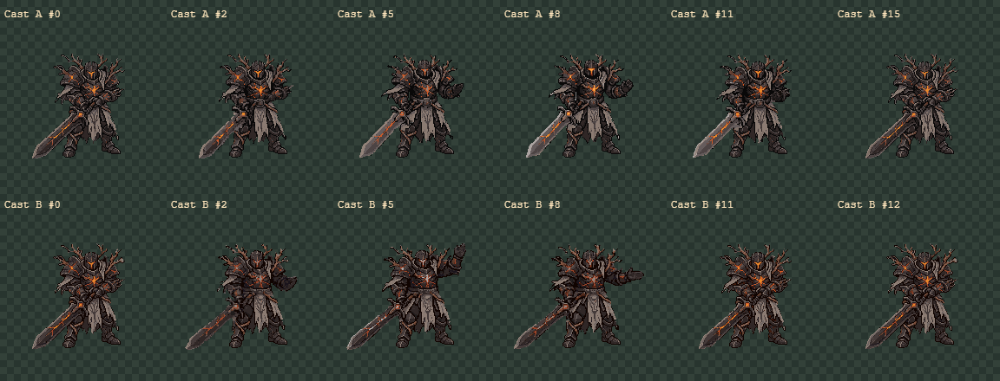
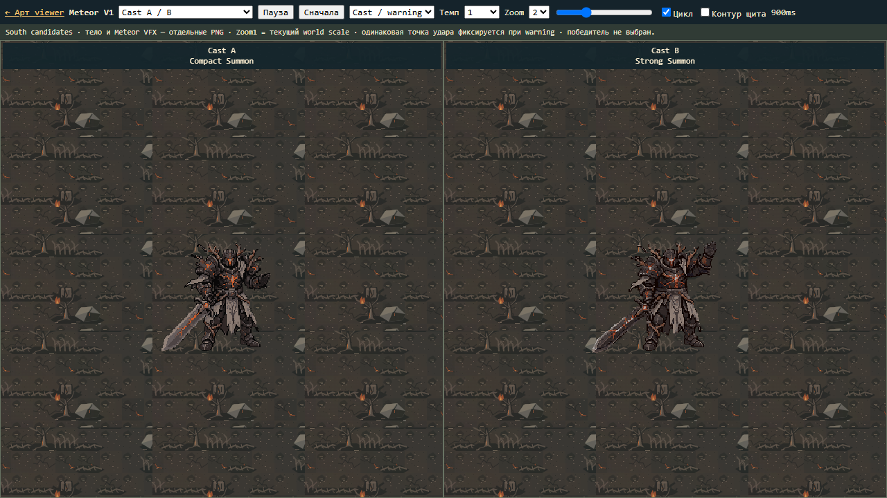
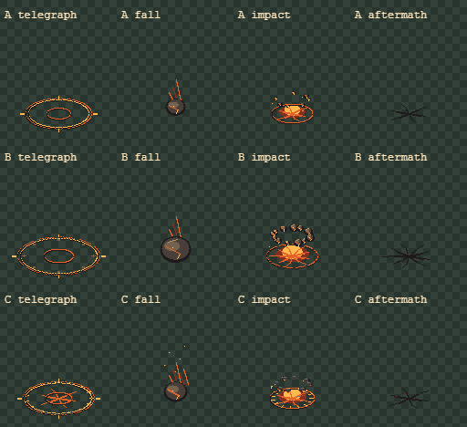
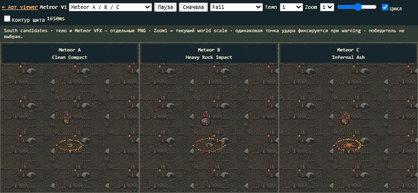
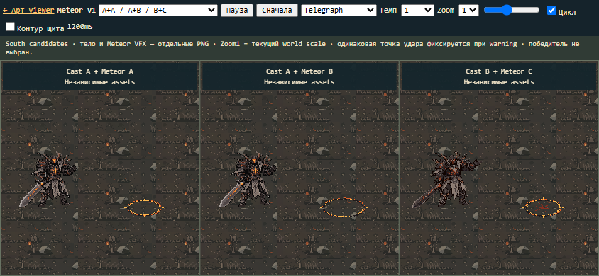

# Ash Warden Meteor V1 — кандидаты, 2026-11-07

**Подготовлены2Cast и3Meteor VFX для ручного выбора. Победитель не назначен.**
South only. Кадры тела и четыре компонента Meteor независимы. Принятые
Idle/Walk/Basic Melee/Charge пакеты и production gameplay не изменены.
Текущая ветка — main; commit/push/deploy не выполнялись.

## Cast A / B

|Кандидат|Жест|Review clip|meteorRelease|
|---|---|---|---|
|A · Compact Summon|Рука у груди, сдержанный вызов, низкий меч|16кадров/1200ms|400ms/frame5|
|B · Strong Summon|Выше поднятая рука, сильнее раскрыты плечи и корпус|13кадров/1440ms|550ms/frame5|

Оба используют один принятый South input192×192. RetroDiffusion Custom Action
дал по12исходных поз×150ms=1800ms. Оригинальные GIF и извлечённые PNG сохранены
без правок. В review версии A добавлены его исходные3/2/1/0 для опускания руки;
B уже возвращается в стойку, добавлен только исходный0 для замыкания.
Исходные12поз не удалены. Есть общий pivot(96,154), world scale0.6548310811;
без per-frame fitting, растягивания или перерисовки принятых ассетов.

Шлем, визор, угольная броня, магма-трещины, ветви, табард и широкий меч узнаваемы.
Меч остаётся пассивным и низким; нет melee/charge или метеора внутри тела.
Каст стационарный, с малым pixel wobble опоры и деталей генерации. Жест A скорее
сжатая/полураскрытая ладонь, чем идеальная открытая кисть; у B есть morphing
брони и локтя. Это first-pass кандидаты для выбора, не финальный anatomy polish.
Малый возврат A через его ранние позы менее плавен, чем завершение B; смотреть GIF.

## Meteor A / B / C

|Вариант|Telegraph|Fall|Impact / aftermath|
|---|---|---|---|
|A · Clean Compact|Чистое компактное кольцо|Малый камень, короткий магматический след|Сдержанный контакт,7обломков, короткая трещина|
|B · Heavy Rock Impact|Более широкое сегментированное кольцо с каменными акцентами|Самый крупный камень|13обломков, выше разлёт, более широкий контакт|
|C · Infernal Ash|Кольцо с трещинами/знаками|Магматический камень с угольными искрами|Пепельные фрагменты,15ember accents, короткие тлеющие точки|

Это оригинальная локальная процедурная pixel-art графика. Нет внешних VFX
генераций, заимствованных спрайтов или screen-filling flame. Палитра — тёмный
камень/пепел, оранжевая магма и ограниченный яркий контакт. У C отдельно усилены
малые пепельные фрагменты, чтобы отличие от A читалось не только по кольцу.
Все3варианта используют общий модульный timing, но свои рисунки/размеры/обломки.

|Компонент|Кадры|Длительность|Review start относительно warning|
|---|---:|---:|---:|
|telegraph|6|900ms|0|
|fall|5|300ms|600ms|
|impact|8|400ms|900ms|
|aftermath|4|320ms|1080ms|

Ground canvas128×128/pivot(64,96), fall canvas128×128/pivot(64,89),
scale0.6548310811. Warning boundary не сжимается; внутренний круг усиливает
предупреждение. Fall перемещается отдельной world transform к фиксированной
цели. Last impact/aftermath frames пустые; lingering mark исчезает.
Радиусы кольца — только визуальные, damageRadius=null. Review timings не меняют баланс.

## Reuse и сравнения

[Открыть Meteor viewer](../../art/generated/ash-warden-meteor-v1/viewer.html).
Ссылка есть также в прежнем locomotion viewer. Режимы:

- Cast A / B;
- Meteor A / B / C;
- Cast A + Meteor A / Cast A + Meteor B / Cast B + Meteor C;
- Multi:3повторных strikes из тех же PNG с разными target positions и задержкой220ms.

Пауза, scrub, этапы cast/warning/fall/impact/aftermath, темп0.25/0.5/1/2,
Zoom1/2/4, loop и необязательный контур shield для оценки читаемости жеста.
Zoom1 показывает текущий game scale; увеличенные режимы — осмотр деталей.
Использован существующий Burning Grove reference. Shattered Grove отдельно
не проверялся, его соответствие оценивается по общей каменной/пепельной палитре.

Release выровнен по900ms общей шкалы: у Cast A/B отличаются моменты начала,
а их собственные длительности не меняются. Тело не перемещается за VFX.
Single и будущий Armageddon — один и тот же strike с независимым instanceId,
targetWorld и start time. Это preview, не добавление Armageddon/Phase3/AI.
Слой щита — только контур preview, не реализация неуязвимости или отдельный ассет.

## Файлы и воспроизведение

`art/generated/ash-warden-meteor-v1/`:

- `cast-a/`, `cast-b/`: исходные12PNG, raw sheets/nearest×4 и frame metadata;
  `review/`: GIF, PNG, sheet, nearest×4 с подготовленным timing/recovery.
- `cast-a-original.gif`, `cast-b-original.gif`, `originals/south-input.png`.
- `meteor-{a,b,c}/{telegraph,fall,impact,aftermath}/`: PNG, GIF, sheet, nearest×4.
- `comparisons/`:25desktop/mobile screenshots и2самостоятельных comparison sheets.
- `metadata.json`, `viewer-data.js`, `INTEGRATION_NOTES.md`: pivots, durations,
  events, placement/depth, single/multi lifecycle и cleanup recommendations.
- `generation-manifest.json`, `cast-*-job.json`, `expenses.json`.
- `vfx-source.mjs`, `decode.mjs`, `build.mjs`, `make-comparisons.mjs`,
  `timing.mjs`, `viewer.mjs`, `verify.mjs`, `protect.mjs` — воспроизводимый workflow.
- `protected-baseline.json`, `validation.json`, `check.log` — проверки.

Всего14итоговых логических клипов:2cast +12VFX.98review PNG (29cast+69VFX),
14GIF previews и14sheets/nearest×4, дополнительно24raw cast PNG и2original GIF.
Подробные команды — `INTEGRATION_NOTES.md`; они не запускают платных запросов.
Viewer запускать через локальный HTTP/dev server, не file://.

## Проверки

- Детерминированная генерация VFX, PNG RGBA, бинарная прозрачность, отсутствие
  edge clipping, три разных набора пикселей каждого компонента.
- Переход900ms: warning/fall закончены, impact frame0. Aftermath необязателен;
  в конце все компоненты отсутствуют. Начальный/финальный cast review кадры совпадают.
- Все14GIF проверены Chromium ImageDecoder по SHA256 каждого RGBA кадра и
  длительности: совпадают с PNG/source, включая пустые финальные кадры.
- Playwright1280×720 и844×390:4режима, warning/fall/impact/aftermath,
  три пары, shield contour, slow0.5/fast2 playback и очистка к концу, без JS errors
  и scroll overflow.25Canvas screenshots сохранены, desktop/mobile/контактные
  листы реально просмотрены. Multi ограничен3strikes и использует те же ресурсы.
- SHA256931файла принятых art packs, src/public совпадает с исходным baseline.
  Production AI, hitbox, damage, баланс и runtime assets не менялись.
- `npm run check`: exit0, typecheck/lint,655/655тестов из82файлов, build успешно.
  После добавления comparison tooling также проверен ESLint нового каталога.
  Прежнее предупреждение Vite о размере bundle сохраняется. Gameplay E2E не
  запускались: gameplay не менялся.

## Расход и статус

Перед генерацией проверены баланс, styles и jobs: баланс$10, Starter61%,
активных задач0. Две оценки Custom Action по$0.25 if balance, суммарно$0.50.
Два запроса на одном input192×192: seeds6110711/6110712, backendrd_fast.
Фактическое списание$0, balance$10→$10, billingplan, Starter61→54%=7п.п.
После A наблюдались57%вjob/58%вaccount; минимум этапа54%. Повторных paid calls0,
North0, VFXgenerationcalls0. Исходные параметры и ответы сохранены.

Оба cast и все3VFX готовы для ручного художественного сравнения. Финальный выбор
пары, дополнительный polish и production integration не выполнялись автоматически.
Работа остановлена для ручной приёмки кандидатов.
